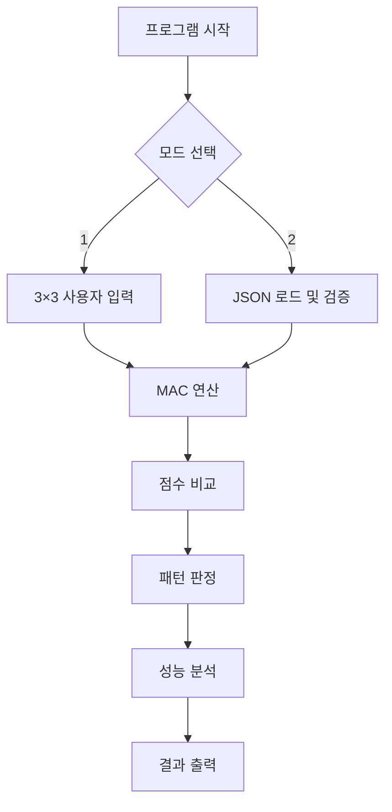

# 🧠 Mini NPU Simulator

> Python으로 구현하는 MAC 연산 기반 패턴 인식 시뮬레이터

<br>


## 1. 프로젝트 소개

Mini NPU Simulator는 AI 하드웨어의 핵심 연산인
MAC(Multiply-Accumulate)을 Python으로 구현한 콘솔 프로그램입니다.

십자가(Cross)와 X 패턴을 숫자 배열로 표현하고,
입력 패턴과 필터의 MAC 점수를 비교하여 패턴을 판별합니다.

외부 라이브러리 없이 Python 반복문으로 직접 구현하여
AI 연산 원리와 데이터 크기에 따른 계산 비용을 학습합니다.

### 개발 목표

- 2차원 배열과 반복문 이해
- MAC 연산 구현
- JSON 데이터 로드 및 검증
- 라벨 정규화
- 부동소수점 허용오차 처리
- 연산 시간 측정 및 시간 복잡도 분석
- 오류 발생 시 원인 진단

<br>

---

## 2. 개발 환경

| 항목 | 환경 |
|---|---|
| 운영체제 | Windows |
| 언어 | Python 3.12.10 |
| 개발 도구 | Visual Studio Code |
| 터미널 | PowerShell |
| 버전 관리 | Git |
| 외부 라이브러리 | 사용하지 않음 |

Python 3.8 이상에서 실행할 수 있도록
표준 라이브러리만 사용했습니다.

<br>

---

## 3. 프로젝트 파일 구조

```text
codyssey-mini-npu/
├── main.py       # MAC 연산 및 시뮬레이터
├── data.json     # 필터와 테스트 패턴 데이터
└── README.md     # 프로젝트 설명 및 결과 리포트
```

<br>

---

## 4. MAC 연산 원리

MAC은 Multiply-Accumulate의 약자로,
곱셈 결과를 누적하여 더하는 연산입니다.

입력 패턴과 필터에서 같은 위치의 숫자를 곱하고,
모든 결과를 합산하여 하나의 점수를 계산합니다.


<br>


### 4.1 입력 패턴

십자가 패턴:

```text
0 1 0
1 1 1
0 1 0
```

X 패턴:

```text
1 0 1
0 1 0
1 0 1
```

<br>

### 4.2 MAC 계산

십자가 패턴과 십자가 필터의 계산:

```text
(0×0) + (1×1) + (0×0)
+ (1×1) + (1×1) + (1×1)
+ (0×0) + (1×1) + (0×0)

= 5
```

동일한 십자가 패턴을 X 필터와 비교하면 1점입니다.

따라서 십자가 필터의 점수가 더 높아 Cross로 판정합니다.

<br>

### 4.3 핵심 코드

```python
def mac(pattern, filter_data):
    score = 0.0

    for i in range(len(pattern)):
        for j in range(len(pattern[i])):
            score += pattern[i][j] * filter_data[i][j]

    return score
```

외부 수치 연산 라이브러리 없이
중첩 반복문으로 모든 위치의 곱셈과 누적 덧셈을 수행합니다.

---

<br>

## 5. 프로그램 실행 방법

<br>

### 5.1 프로그램 실행

프로젝트 폴더에서 다음 명령어를 입력합니다.

```powershell
py main.py
```

<br>

### 5.2 모드 선택

```text
=== Mini NPU Simulator ===

[모드 선택]
1. 사용자 입력 (3x3)
2. data.json 분석

선택 (1/2):
```

<br>

### 5.3 모드 1: 사용자 입력

사용자가 필터 A, 필터 B, 패턴을 각각 3줄씩 입력합니다.

각 행에는 공백으로 구분된 숫자 3개를 입력합니다.

입력된 데이터를 MAC 연산으로 계산하고,
더 높은 점수를 받은 필터를 판정 결과로 출력합니다.

예시:

```text
A 점수: 1.0
B 점수: 5.0
판정: B
```

<br>

### 5.4 입력 오류 처리

- 각 행의 숫자가 3개가 아닌 경우 재입력 요청
- 숫자로 변환할 수 없는 값은 오류 메시지 출력
- 모드 선택에서 1과 2 이외의 입력은 재입력 요청

이를 통해 잘못된 사용자 입력으로 인한
프로그램의 비정상 종료 가능성을 줄였습니다.

---

<br>

## 6. JSON 데이터 분석

<br>

### 6.1 데이터 구성

data.json에는 다음 크기의 필터가 저장되어 있습니다.

- 5×5
- 13×13
- 25×25

각 크기에는 Cross와 X 필터가 존재합니다.

총 6개의 패턴 테스트 케이스가 포함되어 있습니다.

<br>

### 6.2 케이스 키 해석

예시:

```text
size_13_2
```

- size: 패턴 크기를 나타내는 접두어
- 13: 행렬 크기
- 2: 테스트 케이스 식별 번호

프로그램은 키에서 크기를 추출하고
해당 크기에 맞는 필터를 선택합니다.

<br>

### 6.3 라벨 정규화

원본 JSON은 서로 다른 라벨을 사용합니다.

| 원본 값 | 표준 라벨 |
|---|---|
| + | Cross |
| cross | Cross |
| x | X |

프로그램 내부에서는 Cross와 X만 사용합니다.

라벨을 정규화하지 않으면 같은 의미의 데이터도
문자열이 다르다는 이유로 FAIL이 발생할 수 있습니다.

---

<br>

## 7. 부동소수점 및 동점 처리

컴퓨터는 일부 소수를 이진수로 정확하게 표현하지 못합니다.

따라서 계산 결과에 매우 작은 오차가 발생할 수 있습니다.

예시:

```text
0.9000000000000000
0.8999999999999999
```

두 값은 수학적으로 사실상 같은 값이지만,
단순 비교에서는 서로 다른 값으로 처리될 수 있습니다.

이를 해결하기 위해 epsilon 정책을 사용했습니다.

```python
EPSILON = 1e-9
```

판정 기준:

```python
if abs(score_a - score_b) < EPSILON:
    return "UNDECIDED"
```

두 점수 차이가 1e-9 미만이면 동점으로 처리합니다.

동점이 아니라면 더 높은 점수의 필터를 선택합니다.

---

<br>

## 8. 프로그램 실행 흐름




---

<br>

## 9. 실제 테스트 결과

2026년 11월 15일 센터 환경에서 실행한 결과입니다.

| 테스트 케이스 | Cross 점수 | X 점수 | 판정 | 결과 |
|---|---:|---:|---|---|
| size_5_1 | 0.9 | 0.9 | UNDECIDED | FAIL |
| size_5_2 | 8.9 | 0.1 | Cross | PASS |
| size_13_1 | 0.3 | 14.7 | X | PASS |
| size_13_2 | 7.5 | 7.5 | UNDECIDED | FAIL |
| size_25_1 | 4.9 | 4.9 | UNDECIDED | FAIL |
| size_25_2 | 52.9 | 0.1 | Cross | PASS |

### 전체 결과

```text
총 테스트: 6개
통과: 3개
실패: 3개
```

### 실패 케이스

```text
size_5_1  : 허용오차에 따른 동점 판정
size_13_2 : 허용오차에 따른 동점 판정
size_25_1 : 허용오차에 따른 동점 판정
```

---

<br>

## 10. 성능 분석

<br>

### 10.1 측정 방법

Python의 time.perf_counter() 함수를 사용했습니다.

크기별 MAC 연산을 10회 반복하고
전체 측정 시간을 10으로 나누어 평균을 계산했습니다.

측정 구간은 MAC 함수 호출 중심이며,
사용자 입력과 JSON 파일 읽기 시간은 제외했습니다.

<br>

### 10.2 실제 측정 결과

| 행렬 크기 | 평균 시간(ms) | 곱셈 횟수 |
|---|---:|---:|
| 3×3 | 0.000520 | 9 |
| 5×5 | 0.001000 | 25 |
| 13×13 | 0.005610 | 169 |
| 25×25 | 0.019910 | 625 |

측정 환경: Python 3.12.10, Windows, 10회 평균

<br>

### 10.3 시간 복잡도

N×N 행렬에서 MAC 연산은 모든 요소를 한 번씩 방문합니다.

바깥쪽 반복문은 N회,
안쪽 반복문도 N회 실행됩니다.

따라서 총 연산 횟수는 다음과 같습니다.

```text
N × N = N²
```

시간 복잡도는 O(N²)입니다.

3×3에서 25×25로 커지면
곱셈 횟수는 9회에서 625회로 증가합니다.

이는 약 69.4배 증가한 것입니다.

실제 측정 시간은 0.000520ms에서
0.019910ms로 약 38.3배 증가했습니다.

실행 시간의 증가율이 연산 횟수 증가율과
정확히 일치하지 않는 이유는
함수 호출 비용, Python 실행 환경,
CPU 상태 및 짧은 측정 시간의 영향 때문입니다.

---

<br>

## 11. 결과 리포트 및 실패 원인 분석

<br>

### 11.1 실패 원인 분석

1. 전체 6개 테스트 중 3개가 PASS, 3개가 FAIL로 판정되었습니다.
2. FAIL 케이스는 size_5_1, size_13_2, size_25_1입니다.
3. 세 케이스 모두 Cross와 X의 MAC 점수가 같습니다.
4. 프로그램은 점수 차이가 epsilon 미만이면 동점으로 판단합니다.
5. 동점일 때는 Cross나 X를 임의로 선택하지 않습니다.
6. 대신 UNDECIDED라는 판정 불가 결과를 반환합니다.
7. 하지만 해당 케이스의 expected 값은 Cross 또는 X입니다.
8. 따라서 실제 판정과 expected가 달라 FAIL이 발생했습니다.
9. 이 실패는 프로그램의 비정상 종료나 MAC 계산 오류가 아닙니다.
10. 제공된 데이터의 점수 특성과 판정 정책에서 발생한 결과입니다.
11. 라벨 정규화를 적용하여 '+'와 'x'를 표준 라벨로 처리했습니다.
12. 따라서 라벨 표기 차이로 인한 불필요한 FAIL은 방지했습니다.
13. epsilon 비교를 적용하여 미세한 부동소수점 차이도 동점으로 처리했습니다.
14. 이 정책은 비교 결과의 일관성을 유지하는 데 중요합니다.
15. 정확도만 높이기 위해 동점 결과를 임의로 변경하는 것은 적절하지 않습니다.

<br>

### 11.2 실패 유형별 진단

| 실패 유형 | 원인 | 대응 |
|---|---|---|
| 데이터/스키마 | 키 누락, 크기 불일치 | 구조 검증 및 케이스 단위 FAIL |
| 로직 | 잘못된 반복문 또는 필터 선택 | MAC 함수와 필터 매핑 검토 |
| 수치 비교 | 부동소수점 오차 | epsilon 비교 |
| 동점 정책 | 두 점수가 사실상 동일 | UNDECIDED 처리 |

<br>

### 11.3 개선 방향

현재 시뮬레이터는 MAC 점수 비교를 통해
두 패턴 중 하나를 선택합니다.

향후에는 다음 기능을 추가할 수 있습니다.

- 더 다양한 패턴과 필터 지원
- 패턴 자동 생성
- 2차원 배열과 1차원 배열의 성능 비교
- 반복 측정 횟수 확대
- 입력 데이터의 상세 오류 리포트

---

<br>

## 12. 학습 성찰

이번 프로젝트를 통해 AI의 패턴 인식이
숫자 배열에 대한 반복적인 곱셈과 덧셈으로
구성될 수 있음을 이해했습니다.

특히 MAC 연산 자체는 단순하지만,
입력 데이터의 크기가 커질수록
연산량이 빠르게 증가한다는 점을 확인했습니다.

또한 프로그램을 완성하는 것뿐 아니라
입력 검증, 오류 처리, 판정 기준,
성능 측정 및 결과 기록도
중요한 개발 과정이라는 사실을 배웠습니다.

이번 실습은 실제 AI 하드웨어의 병렬 처리 전체를
재현한 것은 아니지만,
NPU가 대량의 MAC 연산을 빠르게 처리해야 하는
이유를 이해하는 기초가 되었습니다.

---

<br>

## 13. 보너스 과제 ① 패턴 자동 생성기

사용자가 행렬 크기와 패턴 종류를 선택하면
Cross 또는 X 패턴을 자동 생성하도록 구현했습니다.

<br>

### 구현 기능

- 3 이상의 홀수 크기 입력
- 최대 25×25 지원
- Cross 패턴 생성
- X 패턴 생성
- 생성된 패턴을 MAC 연산에 재활용
- 연산 결과와 실행 시간 출력

<br>

### 실행 예시

```text
패턴 크기: 5
패턴 종류: X

1 0 0 0 1
0 1 0 1 0
0 0 1 0 0
0 1 0 1 0
1 0 0 0 1

Cross 점수: 1.0
X 점수: 9.0
최종 판정: X
```

패턴을 직접 입력하지 않아도 다양한 크기의
테스트 데이터를 생성할 수 있습니다.

---

<br>

## 14. 보너스 과제 ② 1차원 배열 최적화

<br>

### 14.1 최적화 목적

기존 MAC 함수는 2차원 배열을 사용하여
행과 열 인덱스로 데이터에 접근했습니다.

최적화 함수에서는 2차원 배열을 1차원 배열로 변환하여
하나의 인덱스로 데이터에 접근하도록 구현했습니다.

<br>

### 14.2 핵심 코드

```python
def mac_flat(pattern, filter_data):
    score = 0.0

    for i in range(len(pattern)):
        score += pattern[i] * filter_data[i]

    return score
```

<br>

### 14.3 측정 방법

동일한 입력 패턴과 필터를 사용했습니다.

2차원 방식과 1차원 방식의 계산 결과가 동일한지
먼저 확인한 후 각각 1,000회 반복 측정했습니다.

배열 변환 시간은 측정 구간에서 제외했습니다.

<br>

### 14.4 실제 측정 결과

| 크기 | 2차원(ms) | 1차원(ms) | 속도 비율 |
|---|---:|---:|---:|
| 3×3 | 0.000450 | 0.000254 | 1.77x |
| 5×5 | 0.001051 | 0.000602 | 1.74x |
| 13×13 | 0.005409 | 0.003438 | 1.57x |
| 25×25 | 0.018603 | 0.013883 | 1.34x |


<br>

### 14.5 결과 분석

1. 모든 크기에서 1차원 방식의 실행 시간이 더 짧게 측정되었습니다.
2. 3×3에서는 약 1.77배의 속도 차이가 나타났습니다.
3. 25×25에서는 약 1.34배의 속도 차이가 나타났습니다.
4. 두 방식 모두 N²개의 곱셈을 수행합니다.
5. 따라서 시간 복잡도는 모두 O(N²)입니다.
6. 최적화는 연산 횟수 감소가 아닌 데이터 접근 방식 변경에 해당합니다.
7. Python의 중첩 리스트 접근 비용이 측정 결과에 영향을 줄 수 있습니다.
8. 측정값은 실행 환경과 반복 횟수에 따라 달라질 수 있습니다.
9. 이번 측정에는 2차원 배열을 1차원으로 변환하는 시간이 포함되지 않았습니다.
10. 따라서 전체 처리 시간의 최적화 효과를 판단하려면 변환 비용까지 포함한 추가 실험이 필요합니다.

<br>

### 14.6 결론

이번 실습에서는 동일한 MAC 연산을 수행하더라도
데이터 저장 구조와 접근 방식에 따라
실행 시간이 달라질 수 있음을 확인했습니다.

이는 대량의 반복 연산을 효율적으로 수행하는
AI 하드웨어의 설계 원리를 이해하는 데 도움이 되었습니다.

<br>

---

## 15. 모드별 동점 처리 정책

<br>

### 15.1 동점 판정 기준

본 프로그램은 두 모드에서 동일한 epsilon 정책을 사용합니다.

```python
EPSILON = 1e-9
```

두 MAC 점수의 차이가 epsilon보다 작으면
두 필터의 점수를 사실상 동일한 값으로 판단합니다.

이때 특정 필터를 임의로 선택하지 않고
UNDECIDED(판정 불가)를 반환합니다.

<br>

### 15.2 모드별 처리 방식 비교

| 구분 | 모드 1: 사용자 입력 | 모드 2: JSON 분석 |
|---|---|---|
| 필터 이름 | A / B | Cross / X |
| 입력 방식 | 콘솔 입력 | data.json |
| 동점 기준 | 점수 차이 < epsilon | 점수 차이 < epsilon |
| 동점 결과 | UNDECIDED | UNDECIDED |
| expected 비교 | 없음 | 있음 |
| 동점 후 처리 | 판정 불가 출력 | expected와 비교 후 FAIL 집계 |

두 모드의 동점 판단 기준은 같습니다.

다만 모드 1은 expected 라벨이 없으므로
동점 여부만 사용자에게 안내합니다.

모드 2는 expected 라벨과 비교하므로
UNDECIDED가 Cross 또는 X와 다를 경우 FAIL로 집계합니다.

<br>

### 15.3 동점 처리 정책을 통일한 이유

동점 상황에서 임의로 Cross 또는 X를 선택하면
동일한 입력에 대한 판단 근거가 불명확해집니다.

따라서 두 모드에서 동일한 epsilon 기준을 적용하여
일관된 결과를 반환하도록 설계했습니다.

동점이 발생하면 다음 절차로 원인을 검토할 수 있습니다.

1. 입력 패턴의 행렬 크기가 올바른지 확인
2. 필터 데이터와 입력 데이터 확인
3. Cross와 X의 MAC 점수 비교
4. 두 점수의 차이가 epsilon 미만인지 확인
5. epsilon을 변경하기 전에 데이터와 비교 정책을 검토

본 프로그램은 동점일 때 자동 재시도하거나
임의로 epsilon 값을 변경하지 않습니다.

---

<br>

## 16. 새로운 패턴 라벨 확장 설계

<br>

### 16.1 현재 라벨 구조

현재 프로그램은 다음 두 가지 표준 라벨을 지원합니다.

- Cross
- X

JSON 데이터에서는 다음 입력을 정규화합니다.

| 원본 라벨 | 표준 라벨 |
|---|---|
| + | Cross |
| cross | Cross |
| x | X |

라벨 정규화는 normalize_label() 함수에서 처리합니다.

현재 구현은 2개 라벨의 점수를 비교하는 구조입니다.

<br>

### 16.2 새로운 라벨 추가 절차

예를 들어 Circle이라는 라벨을 추가하려면
다음 순서로 확장해야 합니다.

**1단계: 표준 라벨 정의**

기존 Cross, X 외에 Circle을 추가합니다.

**2단계: 정규화 규칙 추가**

normalize_label() 함수에서
circle 등의 입력을 Circle로 변환하도록 수정합니다.

**3단계: 필터 데이터 추가**

data.json의 각 크기에 Circle 필터를 추가합니다.

**4단계: 필터 선택 구조 확장**

기존 Cross와 X의 두 점수만 계산하는 방식에서
여러 필터의 점수를 계산하는 구조로 변경합니다.

**5단계: 판정 로직 확장**

모든 필터의 MAC 점수를 비교하고
가장 높은 점수의 라벨을 선택합니다.

최고 점수와 다른 점수의 차이가 epsilon 미만이면
동점 정책에 따라 UNDECIDED로 처리합니다.

**6단계: 테스트 케이스 추가**

Circle 패턴과 expected 값을 가진
새로운 JSON 테스트 케이스를 추가합니다.

**7단계: 회귀 테스트**

기존 Cross와 X에 대한 판정이
변경 전과 동일하게 작동하는지 검증합니다.

<br>

### 16.3 확장 시 주의사항

normalize_label() 함수에 Circle만 추가한다고
새로운 패턴을 자동으로 판정할 수 있는 것은 아닙니다.

필터 데이터, 점수 계산, 최종 판정 및
테스트 절차도 함께 확장해야 합니다.

현재 프로그램에는 Circle 기능이 구현되어 있지 않으며,
위 내용은 향후 확장을 위한 설계 절차입니다.

---

<br>

## 17. CPU와 NPU의 연산 구조 및 병목 분석

<br>

### 17.1 CPU 기반 MAC 연산

현재 시뮬레이터는 Python 반복문을 통해
MAC 연산을 수행합니다.

N×N 행렬에서 각 요소에 접근하여
곱셈과 누적 덧셈을 반복합니다.

연산 횟수는 N²에 비례합니다.

이 구현에서는 Python 반복문 실행 비용,
인덱스 접근 및 누적 연산이 실행 시간에 영향을 줍니다.

<br>

### 17.2 NPU 기반 병렬 처리

NPU는 신경망에서 반복적으로 수행되는
곱셈과 누적 연산을 효율적으로 처리하도록 설계된
전용 연산 장치입니다.

많은 연산 유닛을 이용하여
여러 MAC 연산을 병렬로 수행할 수 있습니다.

따라서 대규모 행렬 및 신경망 연산에서
높은 처리량을 제공하도록 설계됩니다.

<br>

### 17.3 CPU와 NPU의 병목 비교


| 비교 항목 | CPU 기반 구현 | NPU 기반 설계 |
|---|---|---|
| 주요 처리 방식 | 일반 목적 명령 실행 | 다수 MAC 병렬 처리 |
| 주요 강점 | 유연한 제어 및 다양한 작업 | 대량의 반복 연산 처리 |
| 연산 관련 병목 | 반복문·명령 실행 비용 | 연산 유닛 활용률 |
| 메모리 관련 병목 | 캐시 미스 및 데이터 접근 | 메모리 대역폭 및 데이터 이동 |
| 개선 방향 | 자료구조·메모리 접근 최적화 | 데이터 재사용·병렬 실행 최적화 |

<br>

### 17.4 병목 발생 사례

25×25 행렬에서는 625개의 위치별 곱셈이 필요합니다.

CPU 기반 Python 구현에서는 반복문으로
각 요소에 접근하여 값을 누적합니다.

반면 병렬 MAC 연산 장치를 활용하는 설계에서는
독립적인 곱셈을 여러 연산 유닛에 분배할 수 있습니다.

하지만 병렬 연산 유닛이 많아도
데이터를 공급하는 속도가 부족하면
메모리 대역폭이 병목이 될 수 있습니다.

따라서 연산 유닛의 개수를 늘리는 것만으로
전체 처리 속도가 무조건 빨라지지는 않습니다.

<br>

### 17.5 병목 개선 전략

**CPU 측면**

1. 불필요한 반복 연산 최소화
2. 1차원 배열로 데이터 접근 단순화
3. 캐시 친화적인 데이터 배치 검토
4. 반복 측정으로 성능 변화 검증

**NPU 설계 측면**

1. 독립적인 MAC 연산 병렬 실행
2. 필터 및 입력 데이터 재사용
3. 온칩 메모리를 활용한 데이터 이동 감소
4. 타일링 및 블록 단위 연산 검토
5. 연산 유닛 활용률과 메모리 대역폭 균형 고려

<br>

### 17.6 실제 실험과의 연결

이번 프로젝트에서는 2차원 배열과
1차원 배열의 MAC 실행 시간을 비교했습니다.

1차원 배열 방식이 약 1.34~1.77배 빠르게 측정되었습니다.

이는 자료구조와 접근 방식이
연산 시간에 영향을 줄 수 있음을 보여줍니다.

다만 이번 실험은 CPU에서 실행한 Python 프로그램이며,
실제 NPU 하드웨어의 병렬 처리 성능을 측정한 것은 아닙니다.

따라서 NPU의 실제 성능 향상률을
이번 측정값만으로 추정할 수는 없습니다.

<br>

### 17.7 결론

대규모 AI 연산의 처리 속도를 높이기 위해서는
연산의 병렬화뿐 아니라 데이터 이동과
메모리 접근 효율도 함께 고려해야 합니다.

이번 Mini NPU Simulator를 통해
MAC 연산의 구조와 연산량 증가를 확인하고,
데이터 구조 변경에 따른 성능 차이를 실험했습니다.
